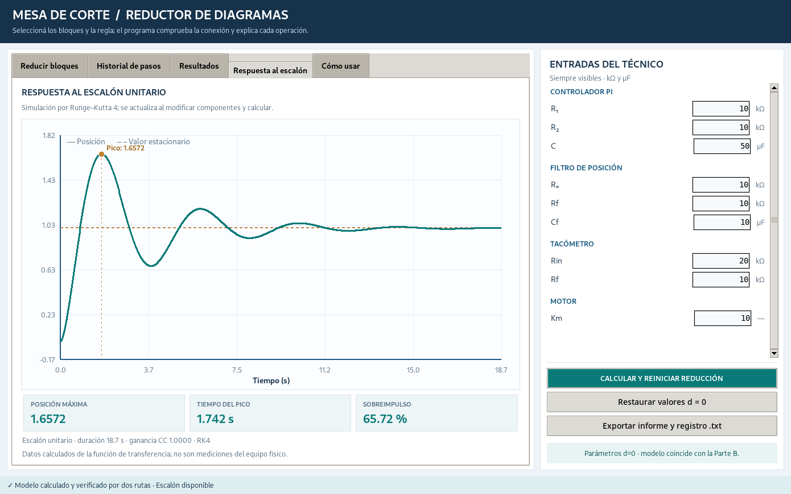

# Mesa de corte — Reductor interactivo de diagramas de bloques

Aplicación de escritorio desarrollada en **Python, Tkinter y SymPy** para estudiar y reducir el diagrama de bloques de un sistema de posicionamiento de una mesa de corte accionada por un motor de corriente continua.

## Funciones principales

- Calcula los bloques del sistema a partir de resistencias, capacitores y ganancia del motor.
- Permite seleccionar y deseleccionar bloques haciendo clic en el diagrama.
- Aplica las reglas de **paralelo, serie y realimentación negativa**, verificando que la conexión corresponda al diagrama actual.
- Sustituye los bloques reducidos por sus equivalentes y guarda el procedimiento en un historial con fórmula, sustitución y resultado.
- Obtiene las funciones de transferencia de **posición C(s)/R(s)** y **velocidad Ω(s)/R(s)**.
- Muestra coeficientes, polos, ceros y ganancia en corriente continua.
- Comprueba dos rutas algebraicas de reducción mediante SymPy.
- Simula una respuesta al escalón unitario con Runge–Kutta de cuarto orden (RK4) e informa el pico, su tiempo y el sobreimpulso.
- Permite exportar los resultados y el registro a un archivo `.txt`.

## Cómo ejecutar

**Requisitos:** Python 3, paquete `sympy` y biblioteca `tkinter` (habitualmente incluida en Python para Windows).

Instalar SymPy en la terminal:

```bash
python -m pip install sympy
```

Abrir `Herramienta_Mesa_Corte_V4_Indicadores.py` en **Thonny** y presionar **F5**; alternativamente:

```bash
python Herramienta_Mesa_Corte_V4_Indicadores.py
```

## Parámetros iniciales del caso de estudio

Las resistencias se introducen en **kΩ** y las capacitancias en **µF**.

| Parámetro | Valor inicial |
| --- | ---: |
| R1, R2 | 10 kΩ, 10 kΩ |
| C | 50 µF |
| Ra, Rf | 10 kΩ, 10 kΩ |
| Cf | 10 µF |
| Rin y Rf del tacómetro | 20 kΩ, 10 kΩ |
| Km | 10 |

En este caso, el modelo calculado de posición es:

```text
C(s)/R(s) = (10s² + 120s + 200) / (s⁴ + 20s³ + 100s² + 100s + 200)
```

La ganancia en corriente continua es **1**. Para la simulación de escalón unitario, el programa calcula aproximadamente un pico de **1.6572**, un tiempo de pico de **1.742 s** y un sobreimpulso de **65.72 %**, utilizando las condiciones iniciales nulas y los parámetros originales.



## Procedimiento de reducción

1. Seleccionar los bloques `Kp` y `Ki/s` y aplicar **Paralelo**.
2. Seleccionar `G2` y `H1` y aplicar **Realimentación negativa**.
3. Seleccionar los equivalentes obtenidos junto con `G3` y aplicar **Serie**.
4. Seleccionar la trayectoria directa resultante y `H2`, y cerrar el lazo con **Realimentación negativa**.
5. Verificar que el resultado final coincida con la función obtenida mediante la expresión algebraica alternativa.

El programa no permite aplicar libremente una regla incompatible con las conexiones reales del diagrama. Los valores y la respuesta al escalón son resultados del **modelo matemático**, no mediciones experimentales de una mesa de corte física.

## Proyecto académico

Herramienta desarrollada como parte de una evaluación de Ingeniería de Control. El código fue desarrollado y revisado con asistencia de IA documentada en la bitácora del informe académico.
